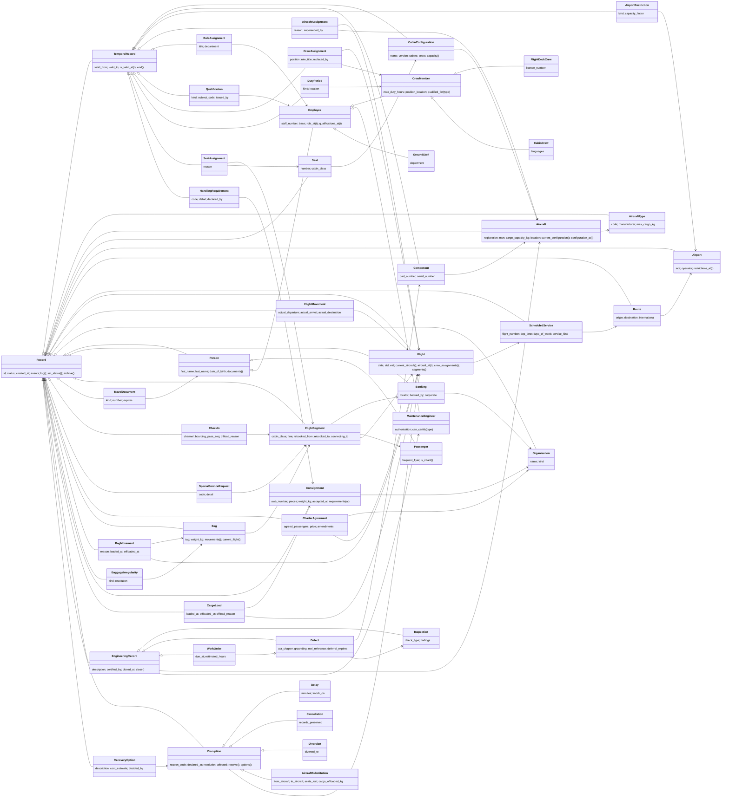

# Class diagram (item 4)

Paste the block below into any Mermaid renderer (Cursor previews Markdown with Mermaid;
https://mermaid.live also works). Inheritance is drawn with `<|--`; the main associations
with `-->`. Attribute lists are kept short on purpose - the Design tab of the console shows
the live, complete class list.

